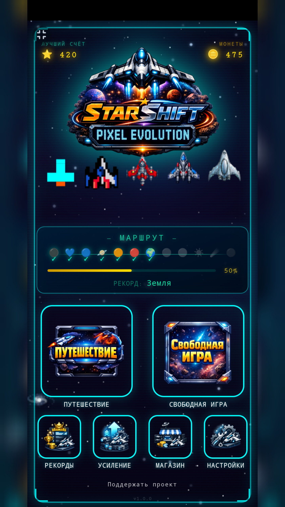
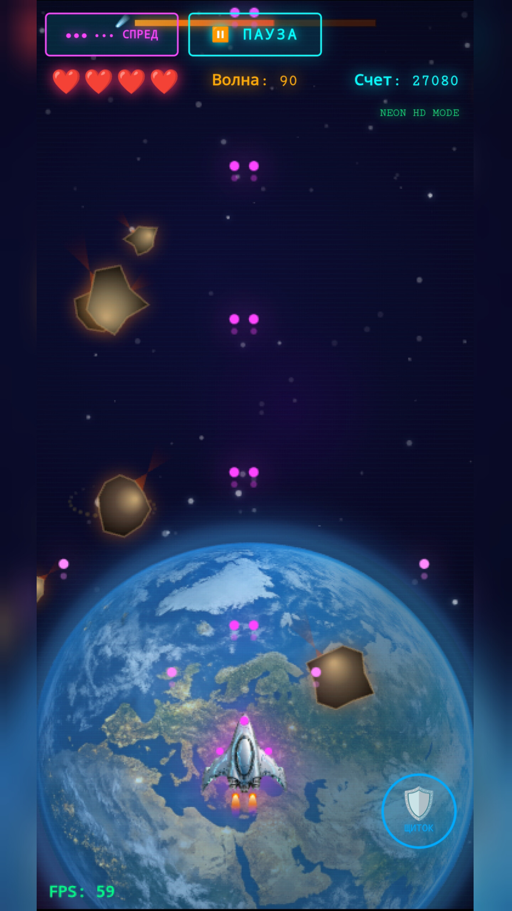
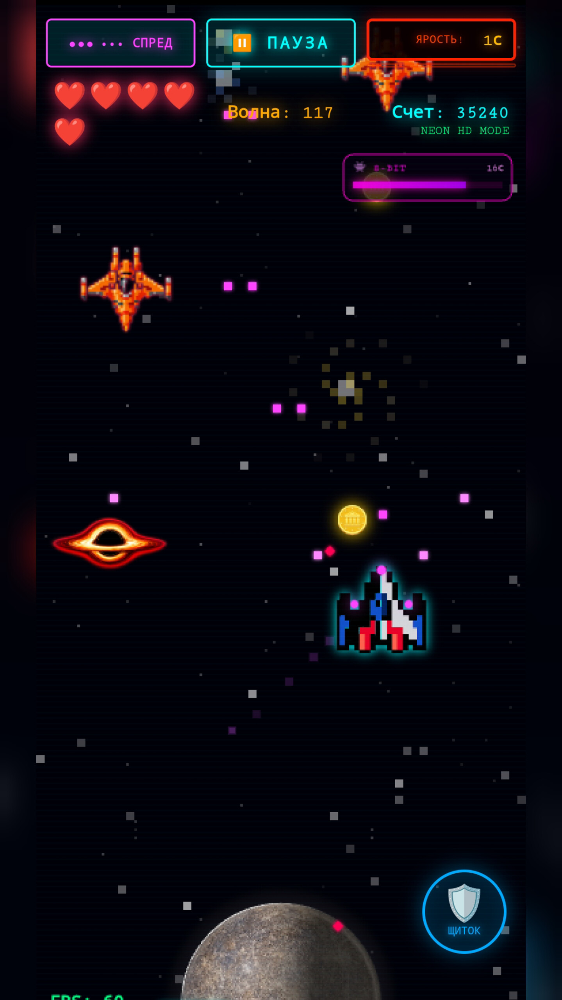
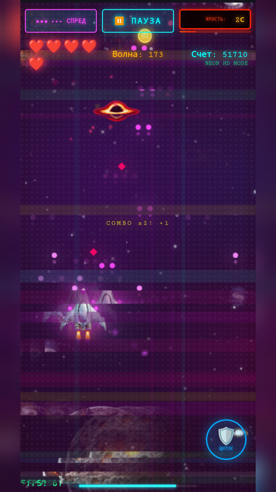
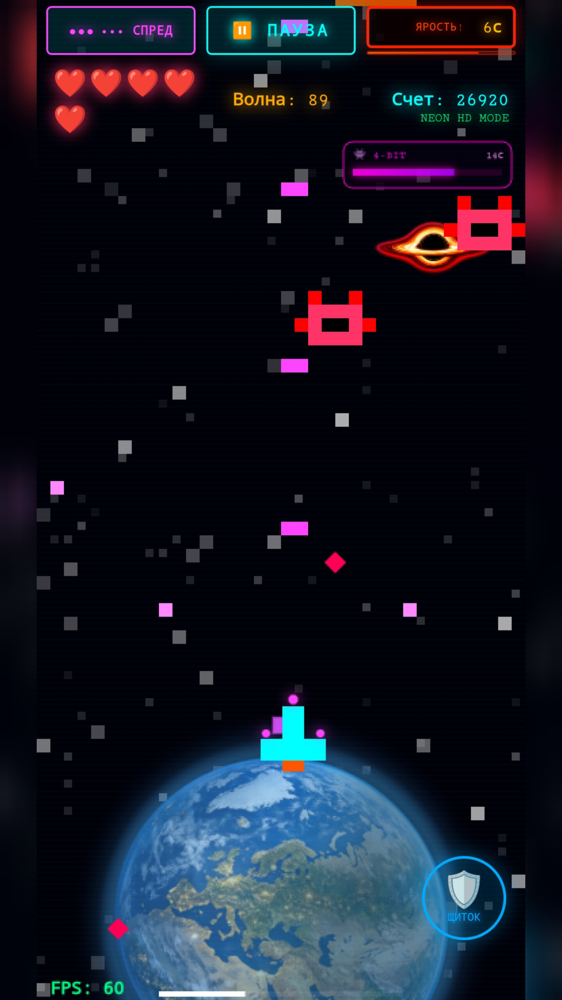

# 🚀 Starshift

**Starshift** — захватывающая космическая аркада с глубокой системой прокачки! Возглавь эскадру звёздного флота, пройди через бескрайние просторы галактики и стань легендой межзвёздных войн.
*(Captivating space arcade with a deep upgrade system! Lead a star fleet squadron, travel through the vast galaxy, and become a legend of interstellar wars.)*

## 🎞️ История создания / The Story Behind

🇷🇺 Я всегда любил классические космические аркады — те, где можно просто взять телефон, запустить игру и улететь в космос без интернета и рекламы. Но современные мобильные игры часто перегружены микротранзакциями и требуют постоянного подключения. Так появилась идея создать Starshift — честную аркаду, где весь контент доступен за игровые достижения, а не за деньги.

🇬🇧 I've always loved classic space arcades — the kind where you can just pick up your phone, launch the game, and fly into space without internet or ads. But modern mobile games are often overloaded with microtransactions and require constant connection. That's how the idea for Starshift was born — an honest arcade where all content is unlocked through gameplay achievements, not money.

## ✨ Ключевые особенности / Key Features

### 🎮 Два режима игры / Two Game Modes
- **🌌 Космическое путешествие** — сюжетная кампания с нарастающей сложностью и уникальными миссиями
- **♾️ Свободная игра** — бесконечный режим на выживание, где ты проверяешь свои навыки и рефлексы

### ⚔️ Система прокачки / Upgrade System
- Улучшай характеристики корабля: скорость, урон, защиту, маневренность
- Открывай новые виды оружия и модулей в магазине
- Разблокируй уникальные корабли с особыми способностями
- Прокачивай пилота и открывай новые навыки

### 🏆 Рекорды и достижения / Records & Achievements
- Собирай очки и поднимайся в таблице лидеров
- Выполняй сложные задания для получения наград
- Соревнуйся с самим собой — каждый запуск может стать новым рекордом!

### 🎨 Атмосфера / Atmosphere
- Стильная пиксельная графика с яркими эффектами взрывов и частиц
- Эпичный электронный саундтрек, создающий напряжение в каждом бою
- Плавная анимация и отзывчивое управление

### 📱 Удобство / Convenience
- Интуитивное управление одним пальцем — идеально для мобильных устройств
- Адаптивный интерфейс под любой размер экрана
- Автосохранение прогресса — играй с того же места, где остановился

## 🔒 Честная игра / Fair Play

| ✅ | 🇷🇺 | 🇬🇧 |
|---|---|---|
| 📡 | **Полностью офлайн** — играй в самолёте, метро или в лесу без интернета | **Fully offline** — play on a plane, subway, or in the forest without internet |
| 🚫 | **Без навязчивой рекламы** — ничто не прервёт твой полёт | **No intrusive ads** — nothing will interrupt your flight |
| 💰 | **Без обязательного доната** — весь контент доступен за игровые достижения | **No mandatory donations** — all content is available through gameplay |
| 📦 | **Минимальный размер** — не занимает много места на телефоне | **Minimal size** — doesn't take up much space on your phone |
| ⚡ | **Оптимизация** — работает плавно даже на бюджетных устройствах | **Optimized** — runs smoothly even on budget devices |

## 🖼️ Скриншоты / Screenshots

<table>
<tr>
<td></td>
<td></td>
<td></td>
<td></td>
<td></td>
</tr>
</table>

## 📥 Скачать / Download

### APK (Android)
📥 **[Скачать последнюю версию (v1.3)](https://github.com/Paminabea/Starshift-app/releases/download/v1.3/StarShift_V_1_3.apk)**

### Магазины приложений / App Stores
- [RuStore](https://www.rustore.ru/catalog/app/com.starshift.app)
- [Huawei AppGallery]() *()*

## 🛠️ Технологии / Tech Stack

- **HTML5 Canvas** — рендеринг графики и анимаций
- **JavaScript** — игровая логика и физика
- **CSS3** — интерфейс и меню
- **Capacitor/Cordova** — упаковка в APK

## 👨‍💻 Автор / Author
**Сергей (Paminabea)**  
GitHub: [@Paminabea](https://github.com/Paminabea) | Email: paminabea@gmail.com

## 📄 Лицензия / License
MIT License — см. файл [LICENSE](LICENSE)

